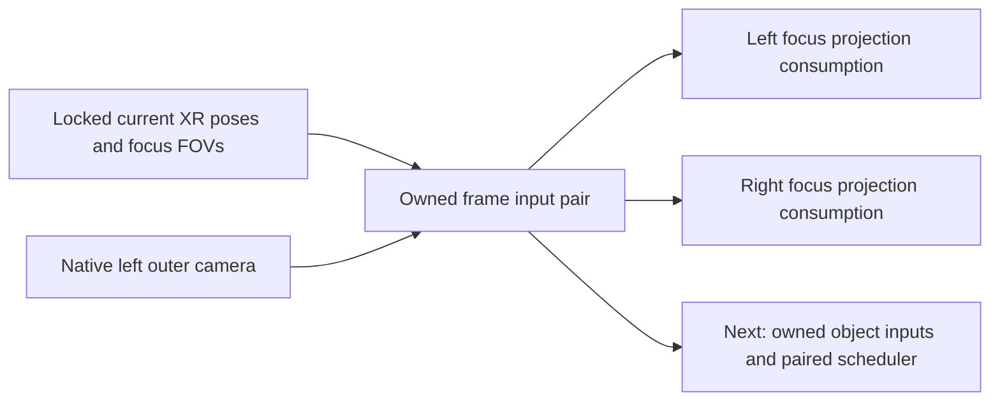

# Early owned focus-camera inputs

Implementation proceeds with shared preparation followed by portable stereo
instancing. Profiling is deferred; the earlier rough capture does not gate this
work. This component supplies current-frame camera numbers needed by the future
paired scheduler. It does not yet replace the native opaque pass.

## Runtime data flow

`xr_frame_inputs` copies all four flat XR views and identifies their session,
frame, predicted display time, reference space and rendering thread. Reading it
locks the same locate result used for rendering and submission. Late/failed or
foreign-space locate calls cannot silently replace that frame. Output is cleared
on failure, and a session serial survives State resets and reused XR handles.
Extension-chain pointers are not retained.

Before left focus begins, `prepare_native_stereo_focus_inputs` combines the real
focus FOVs with the copied native left camera. It owns left/right projection,
far-projection, current and derived matrices plus tracking-space poses. Native
normal and far depth conventions remain separate, including reversed Z. FOV
coefficients are calculated once per focus eye and shared between its two depth
projections. No native methods are called on copied objects.

The right current/derived matrices reuse the existing restricted camera model:
camera mode 0, transform mode 1, rigid equal-orientation relative eyes, zero extra
view offsets and matching native scalar constraints. Canted XR eyes, malformed
poses/FOVs, unsupported perspective or FP controls refuse the whole pair. This
extends the previous outer-only numeric model with actual XR focus FOV inputs;
it does not turn its bounded live evidence into general camera validation.

The normal eye-rendering path consumes the prepared focus projections in left,
then right order. It requires the exact frame, thread, scene and view identities,
and bit-identical expected native outer normal/far projections. A camera/depth
change, duplicate eye, wrong order or stale frame discards the pair and uses
ordinary per-eye projection construction. The predicted right current/derived
matrices do not overwrite the native right view. Native camera world position,
transform-record metadata, history, frustum/cache updates and both eye draws
continue through their existing paths.

This is an actual runtime producer and projection consumer, with no per-draw
capture, readback or profiling requirement. It is opt-in with `-SpsPreparation`
or `LMU_QV_SPS_PREPARE=1`, and works with diagnostics disabled. Default launches
keep the existing behavior.

## Development run

The prepared package includes `Start-SPS-Preparation.cmd`. It reads the saved
provider/game/runtime settings and enables this stage with profiling and heavy
audit disabled. Normal gameplay is sufficient; no timing hotkey or fixed-duration
capture is required. A bounded readiness/fallback message and teardown counts
identify whether the path was used when diagnostics are enabled.

## Remaining integration

The full MSVC native suite passed. New owned-input tests passed at `/Od` and
`/O2`, including asymmetric focus FOVs, reversed normal/far depth, legacy scale,
translated/rotated relative eyes, FP preservation, invalid right-eye input and
frame/session/space/thread/scene/view/order fallback. The XR integration fixture
passed locked-frame copying, late locate stability, end-frame invalidation and
session identity changes. CLI tests passed, including diagnostics-off operation.

A private offline fixture also exercised four existing captured camera pairs.
Using focus FOVs recovered from the native projection coefficients, the new
producer preserved native normal/far depth and reproduced focus projections
exactly in those samples. Maximum current-matrix entry difference was
0.000183105 and maximum derived-matrix entry difference was 0.000488281. These
are numeric differences, not pixel errors or an image acceptance tolerance.
Recovered FOVs alone do not prove the live XR-frame-input connection.

A subsequent live VectorXR run of `3b9d94e` used the locked current XR inputs
and consumed both prepared focus projections for 10,379 frame pairs, with zero
refused pairs or per-eye fallbacks, followed by clean session teardown. This
validates that connection in the sampled fixed-foveation mode; it does not
establish image equivalence, broader camera/material coverage or a speedup.

This pair is produced after the native left outer pass and before left focus.
The [unfiltered owner/source description producer](SPS-OWNER-INPUTS.md) now uses
an earlier native root boundary, before admission. Late group-31 vectors cannot
supply right-only sources. The new producer preserves selected subtrees but
still needs live correctness validation and complete root coverage. Camera-number
ownership does not own the native scene or its mutable meshes/materials/resources.

Next validate that producer, preserve independent per-eye candidate membership/
order, and assemble owned draw inputs. Native side effects, right engine world
position/history and legal HDR/depth target seeding/consumers must be established
before suppressing native work.
The existing private portable instancing backend then supplies paired draws.
