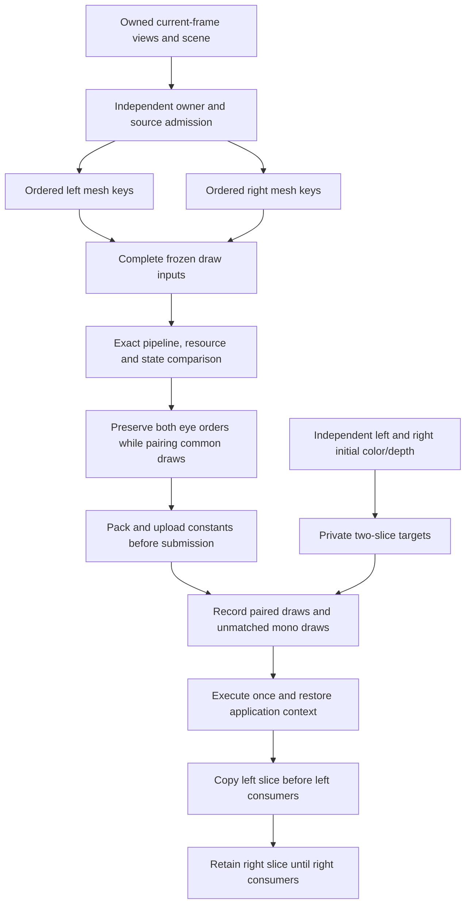

# Owned SPS scene preparation and GPU backend

The branch now contains a working D3D11 batch renderer for fully owned draw
inputs, plus independent per-eye scene classification and ordering. Automated
GPU comparisons pass on WARP and the local hardware device. The opt-in
[SPS rendering adapter](SPS-RENDERING.md) now connects a bounded opaque draw pair
to native D3D11 interception. It keeps native preparation and suppresses each
original draw only after its replacement succeeds. Actual LMU activation,
visual correctness and net performance remain to be validated in game.

## Implemented components

| Component | Behavior | Boundary still required from the engine adapter |
| --- | --- | --- |
| `native_stereo_view_math.hpp` | Native operation order for derived matrices and six outward normalized frustum planes | Current/projection and the separate native position domains for both eyes |
| `native_stereo_view_inverse.hpp` / `native_stereo_view_producer.hpp` | Native cofactor inverse/reciprocal order and complete paired view-number production with original-eye comparisons | Live equivalence of the connected cockpit controls and complete preparation effects |
| `native_stereo_view_inputs.hpp` | Keyed per-eye bounds, classifier and transform inputs; validates native sign-flipped classifier/constant positions | Fresh right-eye world metadata before left rendering; no tracking-space substitution |
| `native_stereo_owner_plan.hpp` | Independent admission for an ordered forest, shared copied state and emission-time states | Complete native bounds and refresh effects, actual selected-root coverage |
| `native_stereo_world_refresh.hpp` | Ordinary native local-scale refresh, attached world products, corner transforms and native AABB/radius; integrated before owner admission, with emission-time world snapshots | Live traversal equivalence; camera-facing and active extra-matrix paths retain native fallback |
| `native_stereo_scene_inputs.hpp` | Actual source classifier fields, separate sorting/classifier positions, lazy-finalizer state and exact native root bias, copied before filtering | Production root scheduling, verified bucket order, full preparation effects and executable draw resources |
| `native_stereo_scene_plan.hpp` | Source position caches, per-eye classification, independent distance ordering and mesh keys | Native finalizers/submission callbacks; established bucket comparator and tie behavior |
| `native_stereo_world_pose.hpp` / `native_stereo_pose_adapter.hpp` | Native cockpit origin/rotation/local-offset input reader; direct eye positions and view matrices with exact left checks | Live right-pose equivalence, bounds metadata and broader camera modes |
| `stereo_constants.hpp` / `native_stereo_constants.hpp` | Owned helper patches, actual VS/PS shadow-to-buffer mapping, shared PS-b5 alias and paired shader CB banks | Complete material/bone preparation and snapshot/version boundaries |
| `stereo_gpu_resources.hpp` | Immutable retention or GPU copies of mutable DEFAULT buffers/2D textures; typed SRV leases | Correct content capture/version points; mapped/dynamic sources currently refuse |
| `stereo_draw_capture.hpp` / `native_stereo_draw_inputs.hpp` | Complete packets from actual bound shaders/layout, geometry, textures, samplers and state, with native CPU-shadow/buffer binding checks; no shader compilation or mapped WRITE reads | Production shader/layout registry, early per-eye preparation and native scheduling/suppression |
| `stereo_pipeline.hpp` | Exact-byte cached original/converted shaders, owned input layouts, direct or GS array routing | Shader bytecode, binding layouts and supported material families |
| `stereo_batch_plan.hpp` | Maximum noncrossing common pairs, retaining each eye's original order | Stable unique draw keys, independent valid input sequences |
| `stereo_constant_arena.hpp` | Deduplicated 256-byte-aligned windows in 64 KiB pages; one WRITE_DISCARD map per page | Owned CB bytes; ordinary-buffer fallback where offsetting is unavailable |
| `stereo_targets.hpp` | Independently seeded two-slice color/depth arrays; ordered copy-back before each eye's consumers | Each eye's real initial state and exact native consumption boundaries |
| `stereo_batch.hpp` | Preflight, exact pairing checks, deferred command recording, single execution with context restoration | Complete owned packets, query-safe native boundary and suppression/teardown integration |

The owner/source planners return `renderingEligible=false`. Their recorded
effects describe outstanding native work, not callbacks to invoke on copied
objects. Source finalization occurs before the native append-mask gate, and
classifier returned flags can differ from stored geometry flags. Both details
are preserved. Unknown intersection preparation and distance tie ordering refuse.

## Draw execution

Pairing uses exact frozen-input comparisons after validation; a matching key or
hash never authorizes it. Different geometry contents, SRV bindings, unconverted
constants, viewport, blend/depth/raster state or draw arguments split a pair.
Conflicting orders become mono actions, rather than reordering either eye.
The supported backend uses indexed triangle lists, one color target and depth,
SM4 source shaders without an original instance-ID input, and no tessellation,
stream output, UAV writes, result-query scope or native geometry shader. Extra
pixel outputs and predicated scopes refuse. The engine adapter must establish
the query boundary; the D3D11 API cannot enumerate all currently active queries.

All allocations, shader creation, packet checks, constant uploads and command
recording finish before execution. Failure leaves native output targets intact.
Execution writes private arrays; `consume(0)` and `consume(1)` copy to the native
banks at their original consumer boundaries. The right slice survives native
bank reuse between those points. Batch, target and constant scopes are not
copyable, and reject stale frame/thread/generation and repeated submission.

Mutable snapshots and target bridging add GPU copies and memory. The producer
should share one lease while its source contents remain valid; the pool does
not infer that a mutable pointer still has the same contents. Dynamic/mapped
resources require a verified producer before they can enter this path. These
costs and native work actually removed must be included in eventual timing.

## Verification

Existing private native captures supplied 16 main view scopes. Their 256 derived
matrix scalars and 384 plane scalars agree bit for bit with the owned view math.
This validates those equations with observed inputs, not predicted right-world
metadata or full rendering equivalence. Captured camera/track fixtures remain
private and are not distributed with source.

The automated tests cover:

- Owner/source masks, right-only membership, multiple roots (including 1,114
  roots), independent sort order, cache reuse, native stored/returned flags and
  atomic refusal at each tested allocation failure.
- All 5,040 permutations of seven draw keys and randomized independent eye
  membership, checked against an independent longest-common-subsequence solver.
- GPU snapshot contents surviving source mutation, immutable reuse, typed SRVs,
  byte budgets and stale/thread/mappable-resource refusal.
- Independent color/depth seeds, a reused native output bank, consumer ordering
  and preservation of every depth sample at 1x, 2x and 4x MSAA.
- 300 distinct constant payloads read back by a shader, deduplication, offsetting
  and ordinary-buffer modes, buffer reuse and generation checks.
- Complete batches compared with separately submitted original-shader passes:
  crossing draw orders, unmatched draws, distinct eye constants, frozen geometry
  and texture changes, exact color/depth, both array-routing paths and both
  constant-upload paths. These pass on WARP and local GPU hardware.

The batch tests exposed the D3D11 command-list-emulation offset-update issue.
On emulated command lists the backend clears old CB bindings and binds a range
whose edges are non-null, including sparse PS slots. This follows Microsoft's
[constant-buffer offset workaround](https://learn.microsoft.com/en-us/windows/win32/api/d3d11_1/nf-d3d11_1-id3d11devicecontext1-vssetconstantbuffers1).
Target copies preserve complete depth/MSAA subresources as required by
[CopySubresourceRegion](https://learn.microsoft.com/en-us/windows/win32/api/d3d11/nf-d3d11-id3d11devicecontext-copysubresourceregion).

## Remaining native implementation

1. Validate the connected cockpit world-pose/view producers and ready owner
   bounds at native traversal; establish real initial HDR/depth state.
   Copying the current left bank twice does not establish right-eye seeding.
2. Connect the ordinary world/source producers to production traversal and preserve source/material/bone/cache
   effects at their original left/right times. The ordinary numeric transform
   alone cannot replace the native preparation wrapper.
3. Produce complete owned draw inputs and exact constant mappings from that
   preparation, including mutable GPU resource content versions. Late visible
   lists and COM pointer retention alone are insufficient.
4. Connect eligible ranges to this backend, preflight before suppressing native
   work, and preserve both consumers and full fallback on transitions/refusal.
5. Validate actual LMU output and CPU/GPU frametimes. Offline equality and fewer
   batch draw calls do not prove the net game performance gain.

No additional in-game collector run is required to use these automated tests.
The expensive owner collector remains an explicit, single-frame diagnostic.

The ordinary world refresh is now an owned implementation rather than an
unresolved callback. It refreshes descendants before owner bounds admission,
including children later rejected by one eye. Disabled subtrees keep the native
skip behavior. Updated matrices are recorded at source emission time, so source
position caches never consume a stale world matrix or another owner's later
state. The native root reader supplies local matrices/metadata/scales, corners
and attachment snapshots; its legacy description-only interface remains available.

The new source-input adapter consumes real object fields while those objects
are in scope. It supplies independently classified source inputs and distinguishes
lazy finalizers that are currently no-ops from those requiring native effects.
It requires an explicit verified bucket order and actual root/clamp bias. It
does not enable continuous collection or suppress native traversal/draws.

Both new components and their owner/source integration have debug and optimized
tests. A private independent interpreter of the saved native world/scale/corner/
radius instructions matches 31,744 output values across 512 synthetic cases
bit for bit at both optimization levels. Captured instructions are interpreted
as data and never executed. This validates the numeric implementation, not its
eventual in-game scheduling or performance.

Native source capture also records actual lazy-finalizer bits and point/spotlight
scan gates. The source planner resolves null/already-finalized sources and
empty/bypassed/zero-limit light scans, preserving scalar vector-end clears.
`sourceEffectsComplete` covers these source effects only; material/bone draw
preparation and rendering eligibility remain separate.

The draw-input adapter now copies complete bindings into executable packets.
Native constant shadows must match actual bound CB identities and ranges. It
requires an established query boundary and cached source-shader/layout metadata;
stale scopes, predication, stream output, unsupported graphics stages/outputs and
mappable geometry refuse. A controlled GPU workload built through this adapter
and native CPU-shadow reader reproduces separate original-shader color/depth
exactly after the original geometry, constants and texture are mutated. The
paired replay passes on WARP and the local hardware device through both routing
paths. The native adapter adds creation-time shader/layout metadata, tracked
resource writes, native query scopes and actual left/right draw interception.
Its hook integration tests remove both original calls while matching separate
native color/depth results. These fixtures use owned data; they do not establish
successful activation in LMU.
