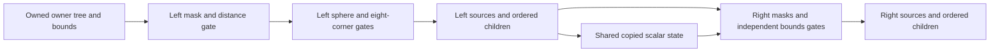

# Owned per-eye owner bounds admission

`native_stereo_owner_bounds.hpp` implements the regular null-source bounds path
observed in `0x41c6f0`, `0x41c500` and `0x418e40`. The owned traversal planner can
now use it for flag `0x80000` instead of rejecting that flag unconditionally.
This is implementation of owned admission, not a native pass replacement.

The caller supplies the actual bounds center, radius, eight world-space corners,
and each eye's independent world position, range and six outward frustum planes.
The center must represent the native bounds helper's center. An object origin,
tracking-space XR eye position or the other eye's planes cannot substitute for
those inputs. Helper `0x3b7270` is now decoded: it computes AABB extrema from
the eight corners, and the admission caller averages those extrema. The input
producer copies ready world corners at owner `+0x150` and radius at `+0xe8`, then
computes that exact center. It preserves native MINSS/MAXSS operand order,
including signed-zero ties. Owners awaiting world refresh keep stale bounds
ineligible for numeric use.

The connected view producer supplies each eye's classifier position, shader
position and separate bounds position. Bounds position uses the native cofactor
inverse with its reciprocal/Newton step, then transforms the view's anchor.
The paired inputs come from the pinned cockpit's common source-camera controls
and independent eye transforms/FOVs. Actual left/right view comparisons check
the mask, controls, positions, full inverse/derived matrices and all six planes.
Live comparisons for this revision have not yet been run in LMU.

The distance gate compares squared distance with squared range plus radius,
including the equality boundary. Sphere tests preserve native scalar operation
order and the early sign-flag write on intersection. The eight-corner gate still
checks all six planes after that early intersection: rejection requires all
eight points to lie strictly outside a plane. Points on a plane remain inside.
The ordered flag writes are returned as owned values. No native methods or
objects are invoked, and the bounds evaluator does not allocate memory.

The traversal planner applies those writes before emitting a source or visiting
children. A bounds-rejected owner still performs its final parent-null flag
clear; an owner rejected by flags/masks does not. A right-only subtree remains
available even when the left eye rejects its parent. Attachments preserve their
native bounds bypass. Both view masks and both bounds views are explicit inputs.

Pending world refresh (`0x400000`), transformed-plane paths (`0x200000`), missing
input and unsupported floating-point controls refuse the plan. Nonfinite inputs
or reached arithmetic return empty results. The full FP environment is preserved.
This does not implement source/material/bone preparation, independent candidate
sorting, native cache effects or GPU target/resource ownership.

Tests exercise exact distance/plane boundaries, all six directions, sphere-first
intersection followed by corner rejection, sticky sign flags, ordered writes,
right-only trees, mask/bounds rejection side effects, attachment bypass, invalid
input/arithmetic and FP preservation at both MSVC optimization levels. Native
bounds equivalence at the traversal boundary remains open. The numeric inverse/
bounds calculation matches 48 scalars across 16 saved native main-view samples
exactly. A separate private reference interprets the saved bounds-helper scalar
operations without executing captured code: all 768 signed-zero center scalars
agree. Every
result remains `renderingEligible=false` through the enclosing planner.

The diagnostic forest collector is separate from camera preparation in source.
`-SpsPreparation` no longer installs its owner hook. Explicit `-SpsOwnerInputs`
with preparation and diagnostics enabled allows one scene frame per engine
session, including a failed attempt. That single capture may still hitch; it is
not a production preparation algorithm. The existing live run already supplies
the required collection evidence, so another collector run is not requested.
